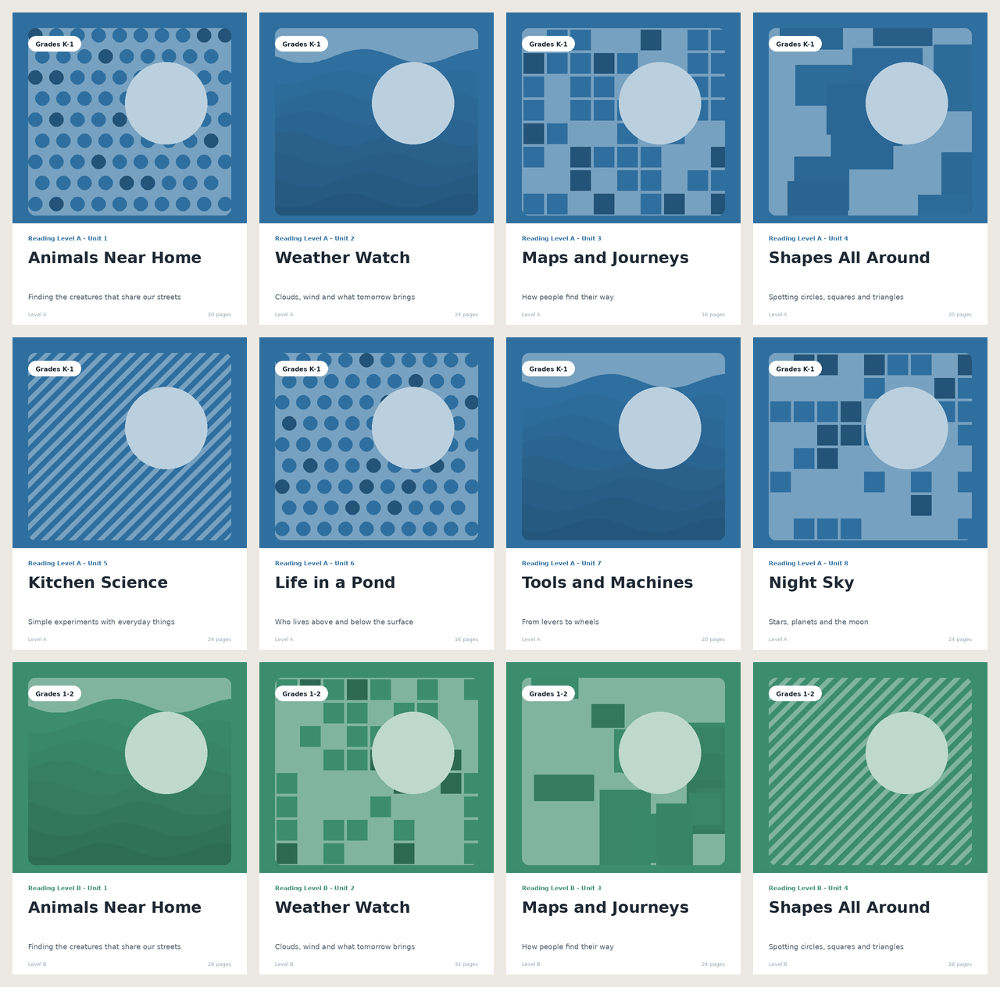

# csv-to-assets

Turn a CSV into a folder of PNG thumbnails and PDFs. One row = one asset per format. The layout is a small JSON template where any value can be `{column}`.

I use a bigger version of this at work to generate product cards and covers from a catalogue export (a few thousand titles per release). This is the core of it, with the company-specific parts removed and sample data made up.



## Install

Python 3.10+. Needs Pillow and reportlab, nothing else.

```bash
git clone https://github.com/yatlagh/csv-to-assets
cd csv-to-assets
pip install -e ".[dev]"
```

## Run it

```bash
csv-to-assets generate --csv samples/books.csv --template templates/card.json --out out/ --formats png,pdf --workers 4
```

```
csv-to-assets: 40 rows x png, pdf | template card (600x800) | 4 worker(s)
[############################]   40/40  rl-e-07
Done: 40 rows -> 40 PNG, 40 PDF in 3.2s using 4 worker(s)
```

Files go to `out/png/` and `out/pdf/`, named from the `id` column (or `title`, or the row number). Bad rows are listed at the end and don't stop the batch.

Options: `--size WxH` scales the whole template, `--name-column`, `--limit N` (useful while tweaking a template), `-q` hides the progress bar.

`csv-to-assets validate --template ... --csv ...` checks the template and that the CSV has every column it uses, without rendering.

## Templates

```json
{
  "name": "card",
  "size": [600, 800],
  "background": { "color": "{color}" },
  "elements": [
    { "type": "image", "box": [40, 40, 560, 520], "src": "{cover_image}", "fit": "cover", "radius": 18 },
    { "type": "pill",  "box": [40, 60, 300, 100], "text": "{grade_band}", "fill": "#FFFFFF" },
    { "type": "rect",  "box": [0, 540, 600, 800], "fill": "#FFFFFF" },
    { "type": "text",  "box": [40, 600, 560, 712], "text": "{title}", "font": "DejaVuSans-Bold",
      "size": 40, "color": "#1F2933", "max_lines": 2, "min_size": 24 }
  ]
}
```

Four element types: `rect`, `image`, `text`, `pill`. `box` is `[x0, y0, x1, y1]`. Text wraps, then shrinks down to `min_size`, then gets an ellipsis. Fonts: DejaVu Sans is bundled, or point at any `.ttf`.

PNGs are drawn with Pillow at 2x and downsampled. PDFs are vector (reportlab) with the font embedded, so the text is selectable. Both renderers use the same layout code, so they match.

Two templates in `templates/`: `card.json` (600x800) and `banner.json` (1200x628).

## Performance

Rows are independent, so they go through a `ProcessPoolExecutor`. The template is parsed once per worker. 40 rows, both formats, ~3s on a 4-core laptop. Thousands of rows is fine; if you need more, split the CSV.

## Dev

```bash
pytest                          # 14 tests
python scripts/make_samples.py  # regenerate the sample CSV and covers
python scripts/make_preview.py  # regenerate docs/preview.png
```

## TODO

- skip rows whose output is newer than the CSV
- `--dpi` for print output instead of `--size`
- webp output

MIT. DejaVu fonts have their own license, see `src/csv_to_assets/fonts/`.
